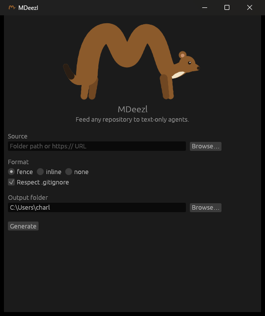

# Test Critique — Sprint 3

## Round 1 — 2026-11-18

Read-only adversarial review of the locked plans, the three result artifacts,
the sprint 3 task records and the four linked intent chapters, with every
claim checked against the code.

### C-001: Nothing fails if `tick`'s 100 ms repaint request is deleted
- **Where:** `gui/tests/app.rs` `test_close_deferral_runs_in_logic_alone` / `test_generate_disabled_while_working`; `build-plan.md` T-004
- **Quote:** "the tick keeps the window waking: {logged:?}" — asserted as `!logged.is_empty() && logged.iter().all(|d| *d <= Duration::from_millis(100))`
- **Failure mode:** weak-assertion
- **Why it matters:** `app.generate(&ctx)` now itself logs a `Duration::ZERO` request *before* `run_logic` runs (that is exactly what `test_generate_requests_a_repaint` asserts), so `logged` is non-empty and ≤100 ms even if `tick` requests nothing; and in `test_generate_disabled_while_working` the `repaint_delay <= 100ms` check is satisfied by `ui.spinner()`, which calls `ui.request_repaint()` "because it is animated" (egui-0.36.2 `src/widgets/spinner.rs:40`). Deleting `ctx.request_repaint_after(POLL)` from `tick` would leave all 29 GUI tests green, yet that line is the whole mechanism behind the EARS promise "each tick **SHALL** request a repaint within 100 ms" and behind INT-0006's minimised-window consequence.
- **Suggested response:** tighten-assertion

### C-002: The no-console-flash test asserts nothing about `CREATE_NO_WINDOW`
- **Where:** `unit-tests.md` T-002 table / `src/lib.rs` `test_git_commands_set_create_no_window`
- **Quote:** "the shared helper applies `CREATE_NO_WINDOW`, and a `git --version` spawned through it still runs and returns output"
- **Failure mode:** weak-assertion
- **Why it matters:** the test body only runs `git_command().arg("--version").output()` and checks the output starts with `git version` — it would pass identically with the `creation_flags` block removed, so the first half of the recorded claim is not asserted anywhere. The EARS clause covers `check-ignore` as well as `clone`, and the manual counter sampled "every 200 ms" over one long clone, which cannot resolve a short `check-ignore` flash.
- **Suggested response:** tighten-assertion

### C-003: Repair 8 (pid in the temp name) has no regression test and contradicts a locked EARS literal
- **Where:** `e2e-tests.md` "The exploratory run" / `build-plan.md` T-004 / `gui/src/lib.rs` `write_output`
- **Quote:** build plan: "write the document to a temporary sibling, `<output>/.<name>.md.mdeezl-tmp`"; e2e: "the temp name carries the pid"
- **Failure mode:** negative-path
- **Why it matters:** the implementation now writes `.{stem}.md.{pid}.mdeezl-tmp`, and the only check anywhere is `no_temp_files`, which matches any name ending `.mdeezl-tmp` — so no assertion would fail against the old shared name. The locked EARS clause names the old literal and `completed-tasks.md` T-004 still records the old one; the deviation is recorded nowhere as an amendment, and the defect it fixes is the only one of the eight with no executed test.
- **Suggested response:** add-test plus record the EARS amendment

### C-004: Two engine behaviour changes contradict locked EARS clauses, with no amendment recorded
- **Where:** `src/lib.rs` `unsupported_source` and `parse_args` / `build-plan.md` T-002, T-001
- **Quote:** T-002: "**WHEN** the source argument is not a URL — including `ftp:/weird`, `git@host:x/y` and `C:\x` — **THEN** mdeezl **SHALL** treat it as a local path, as before."
- **Failure mode:** evidence-drift
- **Why it matters:** `git@host:x/y` is no longer treated as a local path, and `test_cli_explains_a_source_it_cannot_use` asserts the *new* behaviour against a locked clause that says the opposite; separately, the new `other if other.starts_with('-')` arm moves `mdeezl --wrap-none` from exit 1 to exit 2, against T-001's "its exit codes 0, 1 and 2 **SHALL** be unchanged", and makes a directory whose name begins with `-` unbundlable with no `--` escape in `--help`.
- **Suggested response:** defer-with-rationale

### C-005: The frozen-window defect is absent from the repairs table, and its fix has no EARS clause
- **Where:** `e2e-tests.md` "The exploratory run, and what it repaired" / commit `b4b245f` / `gui/src/lib.rs` `generate`
- **Quote:** e2e: "Eight defects were found by operating the thing, and repaired in `de66382`"
- **Failure mode:** evidence-drift
- **Why it matters:** a live run found the real window drawing no frames for a whole 27 s fetch — the most direct contradiction of INT-0006's "Responsive while working" — and that repair is in a different commit, outside the eight-row table, while the manual-check row reports a later clean run as though the mechanism had always worked. The fix matches no EARS clause: "each tick **SHALL** request a repaint within 100 ms" never bootstraps, because `tick` only runs when a frame runs.
- **Suggested response:** defer-with-rationale

### C-006: The README's "a URL source needs git" is proved by a needle that `.gitignore` already satisfies
- **Where:** `tests/cli.rs` `test_readme_documents_desktop_app` / `test-plan.md` E2E list
- **Quote:** test plan: "`.md`, `replac`, and `git`"
- **Failure mode:** weak-assertion
- **Why it matters:** the `## Desktop app` section contains "**Respect .gitignore**", so `flat.contains("git")` is true even if "A URL source needs git on your PATH." is deleted. The test plan warns about exactly this vacuity for the help text and then commits it in the sibling test.
- **Suggested response:** tighten-assertion

### C-007: The unwritable-output test no longer reaches the write path it is traced to
- **Where:** `gui/tests/app.rs` `test_generate_unwritable_output_writes_nothing` / `gui/src/lib.rs` `generate` / `test-plan.md` T-004 row
- **Quote:** test plan: "the output path is an existing *file*. An error is shown, and the file's contents are unchanged."
- **Failure mode:** integration-drift
- **Why it matters:** the Test Phase added the `!dir.is_dir()` guard, so this test short-circuits before any job runs; it duplicates `test_generate_rejects_an_output_that_is_not_a_folder`, and the traceability row for "WHEN the job or write fails THEN error, temp removed, existing file untouched" leans entirely on `test_failed_job_keeps_existing_output`. The new `Not a folder:` status is a third validation message with no EARS clause.
- **Suggested response:** add-test plus record the new status

### C-008: `output_stem`'s composition into the written filename is never exercised
- **Where:** `gui/tests/app.rs` `test_output_stem_is_one_component`, `gated_bundle` / `build-plan.md` T-004
- **Quote:** build plan: "With this rule the file always lands inside the output folder."
- **Failure mode:** stub-leak
- **Why it matters:** every injected job returns `name: "gated"`, and the real-job tests use fixture names that are already safe — so `output_stem` is proved only as a pure function, and nothing proves `write_output` applies it.
- **Suggested response:** add-test

### C-009: No executed negative test for an unauthorised repository
- **Where:** `INT-0002` Acceptance criteria / `build-plan.md` T-002
- **Quote:** INT-0002: "Network and authentication failures produce a diagnostic on stderr and a non-zero exit, never a partial document on stdout."
- **Failure mode:** negative-path
- **Why it matters:** the suite covers missing, unreachable, stalled, disallowed-protocol and git-absent, but nothing exercises an authentication failure. The only evidence is a planning-time measurement quoted in the chapter, not a sprint-3 executed test.
- **Suggested response:** add-test, or state the gap explicitly

### C-010: "No other step may be added" to CI has no test and no mutation row
- **Where:** `build-plan.md` T-005 / `tests/cli.rs` `test_ci_updates_installs_and_logs_in_order` / `integration-tests.md` mutation table
- **Quote:** build plan: "No other step, and no key, **SHALL** be added or changed."
- **Failure mode:** EARS-coverage
- **Why it matters:** an *added* step — the exact failure T-005's note anticipates — would keep the guard green, and none of the 41 mutation rows adds one, so the "no package install" promise rests solely on reading two CI logs.
- **Suggested response:** add-test

### C-011: The human-verification figure is untracked, and the quoted verdict is a design choice, not a verdict on the screenshot
- **Where:** `e2e-tests.md` "Human verification" / `git status`
- **Quote:** "" … "just do this one and call it a day."
- **Failure mode:** evidence-drift
- **Why it matters:** `window.png` is untracked at the tested head, so the one artefact INT-0006's eighth criterion turns on is not in the repository the report will cite. The quoted words are T-006 design directions plus a choice between two throat variants, not a verdict on the screenshot shown in this phase. The design the user chose landed in `e015bf1`, after T-006's recorded commit `5963ace`, whose record still says "opaque share measured at 0.177".
- **Suggested response:** commit the screenshot, quote the actual verdict, name the real commit

### C-012: The protocol allow-list test now covers a path no input can reach, and its real trigger is untested
- **Where:** `src/lib.rs` `test_fetch_rejects_protocol_outside_allow_list`, `bundle_in` / `INT-0002` Alternatives
- **Quote:** INT-0002: "An `insteadOf` rule can rewrite an https URL to ssh. The allow-list turns that into a fast failure"
- **Failure mode:** weak-assertion
- **Why it matters:** `bundle_in` now rejects `ssh://…` before `fetch` is called, so the literal case the test drives is unreachable from the CLI or the GUI; the scenario the allow-list exists for — an `insteadOf` rewrite — has no test.
- **Suggested response:** add-test, or state the coverage honestly

### C-013: Evidence the report must carry is in none of the three result artifacts
- **Where:** `test-plan.md` Intent Traceability rows 13 and 25 / `unit-tests.md`
- **Quote:** test plan: "`test_manifest_dependencies_table_is_empty` (unedited); literal `cargo tree -p mdeezl` output in the report"
- **Failure mode:** evidence-drift
- **Why it matters:** no artifact records the `cargo tree -p mdeezl` output or names that test, and nothing repeats the locked deferral of INT-0002's criterion 2. Both chapters still read "Test evidence: none".
- **Suggested response:** defer-with-rationale

### C-014: `test_dropping_app_waits_for_worker` can pass without the drop ever waiting
- **Where:** `gui/tests/app.rs` `test_dropping_app_waits_for_worker`
- **Quote:** "the drop returned before the job ended"
- **Failure mode:** flake-risk
- **Why it matters:** the releaser thread sleeps 200 ms and the assertion is only that `done` is true after `drop(h)` — if the main thread is descheduled past 200 ms the job has already finished and the drop returns instantly, passing vacuously on a cleanup guarantee.
- **Suggested response:** tighten-assertion

### Confidence
block

## Response to round 1

Seven concerns were confirmed the hard way, by deleting the mechanism and
running the tests the records credit with proving it. Each of those mutations
now turns red, named by the test that catches it.

| Concern | Response | Evidence |
|---------|----------|----------|
| C-001 tick's repaint | **tighten-assertion.** `test_close_deferral_runs_in_logic_alone` now runs a control pass with no tick, which records no request at all, before the pass that records the tick's own. | deleting `request_repaint_after(POLL)` → red, `test_close_deferral_runs_in_logic_alone` |
| C-002 `CREATE_NO_WINDOW` | **tighten-assertion.** The flag cannot be read back from outside a process, so the test asserts its two halves on the shipped source: the flag is set in `git_command`, and nothing else there spawns git. | deleting the flag → red; adding a second spawn site → red |
| C-003 temp name's pid | **add-test.** `temp_name` is its own function with `test_temp_name_carries_the_pid`. | removing the pid → red |
| C-004 two behaviour changes | **defer-with-rationale**, plus one repair: `--` now ends the options, so a `-`-leading folder is bundlable again. Both deviations are named in [test-report.md](test-report.md) and in [e2e-tests.md](e2e-tests.md). | `test_cli_names_what_it_could_not_use` |
| C-005 the frozen window | **defer-with-rationale.** It is now the first row of the repairs table, with its own commit, and the EARS gap it exposed is named in the report. | `test_generate_requests_a_repaint` |
| C-006 vacuous `git` needle | **tighten-assertion.** The needle is the sentence, not the word. | deleting the README sentence → red |
| C-007 unwritable output | **add-test.** The test provokes a real write failure inside a valid folder, by blocking the temporary sibling's own name. | it reaches `write_output` again; instrumented and checked |
| C-008 `output_stem` applied | **add-test.** `test_generate_applies_the_stem_rule_to_the_file`. | `write_output` ignoring `output_stem` → red |
| C-009 unauthorised repository | **add-test.** A local socket answers 401; the fetch fails in 0.25 s with "terminal prompts disabled". | `GIT_TERMINAL_PROMPT=1` → red |
| C-010 an added CI step | **add-test.** The guard pins the job's step list exactly, in order, checked last. Mutation row 42 adds a package install. | adding `sudo apt-get install -y libgtk-3-dev` → red |
| C-011 the screenshot | **accepted.** `window.png` is committed beside the record, the quoted words are attributed to what they were (design rounds, and the choice between two variants), and the design's real commit and measured coverage are named. | the test now prints the share: 0.223 |
| C-012 allow-list reach | **defer-with-rationale.** The record now says exactly what the test reaches and that the `insteadOf` route is not executed this sprint. | [unit-tests.md](unit-tests.md) |
| C-013 missing evidence | **accepted.** `cargo tree -p mdeezl` output, the unedited manifest test and INT-0002's git-ref deferral are in the records. | [unit-tests.md](unit-tests.md), [e2e-tests.md](e2e-tests.md) |
| C-014 vacuous drop test | **tighten-assertion.** The job works for 300 ms after release; the test checks it is still running when the drop begins, then that the drop returned only after it finished. | removing the drop-join → red |

One concern was **rejected in part**: C-008's own mutation, removing
`output_stem`'s fallback, was already caught by the pure-function test. The
claim that nothing proved `write_output` *applies* it was correct, and that
is what the new test fixes.

Two things the fixes themselves turned up, both recorded in the results:

- a failed assertion in a gated GUI test wedged the run in the app's
  drop-join for ten minutes, because the worker was waiting for a release the
  panic had skipped. `ReleaseOnDrop` makes such a failure fail fast.
- the first CI run after these fixes was green on Linux and red on Windows:
  the new source check split on `"\n#[cfg(test)]\nmod tests {"`, which a CRLF
  checkout does not contain.

## Round 2 — 2026-11-19

Verdict: **proceed-with-caveats**. The round verified every round-1 fix
against the code: ten were found genuinely fixed, four partly — in each of
those four the *test* was fixed and a *record* still overclaimed. Eight new
concerns followed, numbered C-101 to C-108. They are summarised here with the
response; the fixes are in commit `cb11527`.

| Concern | What it found | Response |
|---------|---------------|----------|
| C-101 | `test-report.md` was empty, and three records pointed at it in the present tense for deviations, the `cargo tree` output and the user's verdict. | **accepted.** The report is written, and carries all of them. |
| C-102 | `unit-tests.md` still said the CI legs ran 1.98.1, contradicting its own header and the logs — and undercutting the one new piece of toolchain evidence this sprint produced. | **accepted.** Corrected to 1.100.0. |
| C-103 | The e2e record claimed every GUI test runs through `Harness::new_eframe`; three drive a bare `egui::Context`. The locked plan had named one exception; this phase added two more and the record dropped the caveat. | **accepted.** The record now names all three, says why each needs a bare context, and names what actually pins the `logic → tick` wiring. |
| C-104 | `--` was documented in `HELP` but asserted nowhere: both lines could be deleted with every test green — the same vacuity class as C-006. The README documented neither `--` nor the new exit 2. | **accepted.** The README documents both, and `test_cli_names_what_it_could_not_use` needles the help text and the README. |
| C-105 | The 401 test's needle list included a bare `"401"`, which an ephemeral port such as 54017 satisfies on its own. | **accepted.** The URL is stripped before the search, and the bare needle is replaced by `error: 401` / `HTTP 401`. |
| C-106 | `test_dropping_app_waits_for_worker` left a 50 ms margin on a wall-clock bound, so a scheduler stall could fail a correct build. | **accepted.** It compares against the job's own finish instant: if the job was already over when the drop began, the arrangement proved nothing and the test says so. The margin is the job's whole 300 ms. |
| C-107 | INT-0006 names an unauthorised URL **in the window**; the new coverage is engine-level, and no record said so. | **defer-with-rationale**, now stated in [e2e-tests.md](e2e-tests.md): the window's half rides on the shared engine path, and what is unproved is only that the two compose. |
| C-108 | The new step guard compared each step's first line only, so an added `with:` or `env:` passed; and it reads one job, so a second job was invisible. | **accepted.** It compares every line of every step and asserts there is exactly one job. Mutation rows 43 and 44 cover both; the table is now 44 rows, 0 not caught. |

The four "partly fixed" verdicts are all answered by the same two things: the
report now exists, and the T-004 temporary-name deviation is recorded in its
deviation table alongside the other five.

## Round 3 — 2026-11-19

Verdict: **block**, on seven concerns (C-201 to C-207). It confirmed seven of
round 2's eight fixes and found the eighth incomplete, then reviewed the new
`test-report.md` hardest, which is where most of what it found lives. All
seven were taken; two were defects in the tests, five were the report
misstating things a reader can check.

| Concern | What it found | Response |
|---------|---------------|----------|
| C-201 | The deviation table named the exit-code change under T-001's clause but not the two stderr rewordings made under the same clause — the table's own stated job. | **accepted.** The row names all three. |
| C-202 | The report said the manual checks ran on a binary "built from the tested head"; the e2e record says `c92ab73` and argues equivalence. The screenshot was committed two commits earlier still. | **accepted.** The report carries the premise and the diff argument, not just the conclusion. |
| C-203 | T-005's clause is "no other step, **and no key**", and the guard could only see inside the job's `steps:` block. A job-level `container:` with the libraries baked in would keep "no package install" true in the log and false in fact. | **accepted.** The guard pins the workflow's own keys, the `on:` block and the job's keys before `steps:`; mutation rows 45–47 cover a `container:`, a narrowed `branches:`, and a `permissions:` key. |
| C-204 | INT-0002's failure criterion is written in command-line terms, but the new unauthorised test asserted only the engine's `Err` — the same composition gap the phase had insisted on recording for the window. | **accepted.** `test_cli_unauthorised_url_exits_1` drives the real binary against the 401 socket. |
| C-205 | The deviation row named only `git@host:x/y`; the refusal is general to every `<scheme>://` outside the three, and a URL with no host now fails differently. The two tests that pin all of it were named in no record. | **accepted.** The row is widened and both tests have their own table in [e2e-tests.md](e2e-tests.md). |
| C-206 | The user's quoted verdict differed between the report and the record it cites, and neither said where the words come from. | **accepted.** Both records quote the same words and say they are the user's messages in this phase's conversation. |
| C-207 | Two counts wrong: rustup is never installed by a run (`--no-self-update`), and the rounds raised 22 concerns, not fourteen. | **accepted.** Both corrected; the figure is now 29 across three rounds. |

A note on the shape of this round: it found almost nothing wrong with the code
and a good deal wrong with the writing about it. That is what a report is for,
and it is why the verdict was `block` rather than `proceed-with-caveats` —
a reader following those claims would have been misled about which binary was
driven, which clause was departed from, and what CI had actually proved.

## Round 4 — 2026-11-19

Verdict: **proceed-with-caveats**, on six concerns (C-301 to C-306). It
confirmed four of round 3's seven fixes outright, found two partly done, and
caught one new defect in the code. All six were taken.

| Concern | What it found | Response |
|---------|---------------|----------|
| C-301 | The "no key" guard still had a blind spot: YAML does not care about key order, so a job-level `container:` written *after* the steps satisfied every assertion — the exact attack row 45 exists for. The guard also read one workflow file. | **accepted.** It compares the job's keys wherever they sit, checks the matrix separately, and asserts the workflows directory holds one file. Mutation rows 48 and 49. |
| C-302 | `unit-tests.md` said the tested head's CI run installed 1.100.0; that run's own step reads `unchanged`. True of the head before it, not this one. | **accepted.** The file now says the images already carried it and points at the two runs that did install it. |
| C-303 | The Windows git version was quoted as 2.56.0.windows.4 in a table whose other rows come from the tested head's run, where it is 2.56.1.windows.1 — the same image refresh that made the update step read `unchanged`. | **accepted.** Corrected in both records. |
| C-304 | "two commits below the tested head" is four — and that sentence was written by the round-3 fix to C-202, so a correction arrived with a new error in it. | **accepted.** Four. |
| C-305 | The deviation row gave a before-state the old code could not produce: `mdeezl --wrap-none` never exited 1 as "unexpected second path". | **accepted**, and measured rather than reasoned: `24442f1` was built in a scratch worktree and run. Alone, the old binary made `--wrap-none` the path and exited **1** with "The system cannot find the file specified. (os error 2)"; after a path it exited 2 as "unexpected second path". Both records now say that. |
| C-306 | The report's header said two critique rounds where its own body said three, and the verdict line undercounted the gaps the body lists. | **accepted.** The header names all four rounds and their verdicts. |

Rounds 3 and 4 between them show the shape of this phase's risk: the code was
sound and the writing about it was not. Five of round 3's seven findings and
five of round 4's six were records claiming something a reader could check and
find false — a wrong binary, a wrong commit distance, a wrong version, a
before-state the code could not emit. Each is now either corrected or measured.
